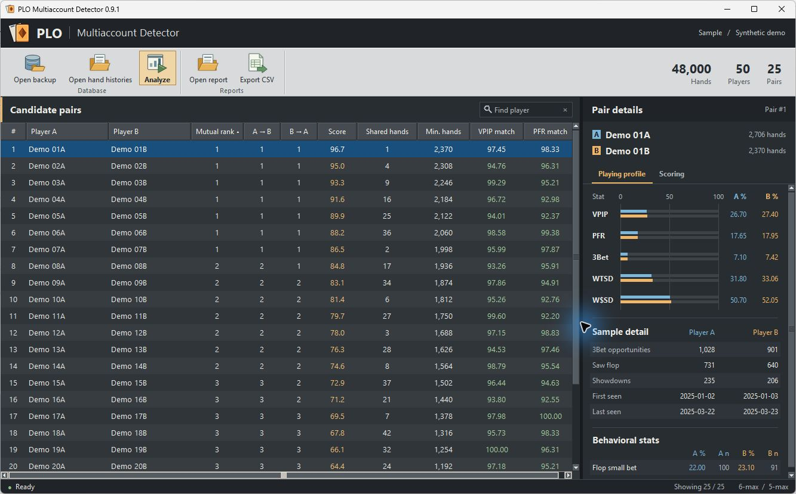

# PLO Multiaccount Detector 0.9.1

A desktop tool that flags Pot-Limit Omaha (PLO) accounts likely operated by the same person using Hold'em Manager 2 hand histories.

## Results

- The bundled iPoker sample contains **150,000 parsed hands** and **2,713 players represented in the statistics**.
- In the chronological split-half test, the other half of an account ranked first by score **16.3%** of the time (Top-1). In the first 100 reported test pairs, **60.0%** matched two halves of one account (P@100).
- Running the bundled backup again with the same configuration reproduces the candidates CSV byte for byte.
- The parser's reconstructed betting amounts matched iPoker's recorded totals for **99.98% of player-hands**.

The default score cutoff of **28** tied for the best precision in the top 500 and had the highest precision in the top 1,000 across the tested cutoffs.

## Limitations

- Earlier and later hands from the same account serve as a proxy for real multi-account cases.
- Both threshold tuning and validation used the same sample.
- Scores flag leads for manual review. Shared ownership requires independent evidence.

## Run on Windows

Extract the Windows ZIP and double-click **PLO-Detector.exe** inside **PLO-Detector-0.9.1**. Python, Tkinter, NumPy, the backup and the sample report are included. [Published Windows release (0.9.1)](https://github.com/Texonja/plo-multiaccount-detector/releases/tag/v0.9.1)

| Ribbon action | What it does |
| --- | --- |
| Open backup | Analyze an HM2 `.pghembk` backup or SQL dump. |
| Open hand histories | Choose an iPoker archive folder, such as `HM2Archive\IPoker\2025\01`. Reads Omaha PL hands from XML files in that folder and its subfolders. Each game ID counts once. |
| Analyze | Rebuild the report from the current backup or hand-history folder using `config.json`. |
| Open report | Open a candidate CSV. Older likelihood scores are converted to the current scale on display and export. Keep the original `summary.json` alongside it for database totals. |
| Export CSV | Save visible pairs in the current order with all report columns. |

The sample opens at startup. Select a pair to compare profiles and open **Scoring** for each stat's contribution. Click a heading to sort, **Ctrl+F** to find a player and **Esc** to clear the search. New analyses go to `reports/`.

## Run from source

Use Python 3.10+ with Tkinter. In the project directory install the runtime dependency, then double-click **OPEN_DETECTOR.bat**.

```powershell
python -m pip install -r requirements.txt
```

**RUN_MULTIACCOUNT_REPORT.bat** runs the batch workflow. In PowerShell the equivalent CLI invocation is:

```powershell
$env:PYTHONPATH = "src"
python -m plo_multiaccount_detector --input database.pghembk --out reports/my_run
```

For a hand-history folder, use `python -m plo_multiaccount_detector --input "I:\HM2Archive\IPoker\2025\01" --out reports/january`.

Add `--no-validate` to skip the self-test. Run the test suite with `python -m unittest discover -s tests`.

To build the portable ZIP using 64-bit python.org Python on Windows with Tcl/Tk installed:

```powershell
python -m pip install -r requirements.txt distlib==0.4.2
python tools/build_windows.py PLO-Detector-0.9.1-Windows-x64.zip
```

## Further reading

- [Methodology](docs/METHODOLOGY.md)
- [Sample shortlist](sample_output/top_candidates.md)
- [Full validation and individual ranks](sample_output/validation.json)


